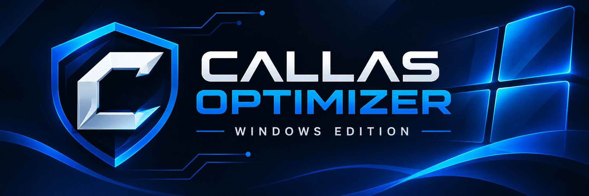

<div align="center">
  

# Callas Optimizer — Windows Edition

**Central de manutenção para Windows 11, com interface gráfica em Python/Qt e atualizações pelo GitHub Releases.**

[](https://github.com/Callas157/Callas-Optimizer-Windows/releases/latest)
[](#compatibilidade)
[](#desenvolvimento)

**[Baixar a versão estável mais recente](https://github.com/Callas157/Callas-Optimizer-Windows/releases/latest)**
</div>

## v8.9.8 — Confiabilidade dos downloads
- Ajustada a verificação da assinatura Authenticode do arquivo temporário com extensão executável.
- Corrigido o ciclo de vida do trabalhador de download para possibilitar instalar vários programas em sequência, sem referência Qt inválida.
- Canal oficial de atualização e distribuição preservados, com apenas um Setup x64 em Releases.
- Verificações locais e testes automatizados de segurança; download real e instalação em Windows 11 IoT LTSC ainda precisam de validação no computador do usuário.

## v8.9.7 — Medal, Logitech G HUB e Spotify

- A Central de aplicativos agora oferece **5 programas**: Brave, NVIDIA App, Medal, Logitech G HUB e Spotify.
- Medal, Logitech G HUB e Spotify podem ser baixados diretamente no programa, sem depender do WinGet (inclusive IoT LTSC).
- Downloads limitados a servidores HTTPS do fornecedor, com validação de executável e **assinatura Authenticode do editor** antes de abrir o instalador original.
- Se o servidor mudar ou o arquivo não tiver assinatura válida, o Callas não executa o arquivo e oferece o site oficial para baixar manualmente.
- Cards com ícones vetoriais e reorganização automática ao redimensionar a janela.
- Mantido o Setup como único executável publicado em Releases; Windows 11 x64 é o alvo de suporte.

## v8.9.6 — Manutenção em Python e correção do carregamento

- Motor de manutenção migrado para **Python/PySide6**, com ações individuais nas 13 funções. Não executa mais o BAT antigo.
- As operações administrativas usam os próprios utilitários do Windows (PowerShell, PowerCfg, DISM, SFC, SC, Registro), com confirmação, logs e backups dos ajustes suportados.
- Instalador **PyInstaller onedir**: os componentes Python/Qt são instalados em Program Files, sem extração temporária `_MEI` a cada inicialização.
- O build do Windows é interrompido se o executável instalado não abrir nos testes.
- Confirmações em **português** (Sim/Não), menu lateral maior e ícones SVG.
- Apenas **Setup.exe** nas Releases. Sem edição portátil.
- Quem está com a 8.9.4 que não abre deve **instalar o novo Setup manualmente por cima**.
- Importante: compatibilidade com uma instalação específica do Windows 11 IoT LTSC, UAC e todas as ações de manutenção ainda requerem validação prática. O SmartScreen pode continuar mostrando alerta até haver uma assinatura digital confiável.

## v8.9.5 — Correção da DLL Python e interface em português
- Corrigido empacotamento para PyInstaller `--onedir` instalado com Python/Qt e dependências permanentes em `Program Files` (evita extração `_MEI` a cada abertura).
- Instalador inclui a pasta `_internal`, e testes falham se `python312.dll` ou PySide6 estiverem ausentes.
- Teste automatizado executa **o aplicativo instalado** no Windows antes de publicar a Release.
- Perguntas de atualização e manutenção usam botões explícitos **Sim / Não** em PT-BR.
- Barra lateral ampliada e com ícones SVG uniformes, em vez de caracteres pequenos.
- Mantida somente a versão Setup para download.
- O alerta de SmartScreen ainda pode aparecer sem assinatura digital.

## v8.9.4 — Ícone corrigido na Área de Trabalho e no menu Iniciar

O instalador agora copia `CallasOptimizer.ico` para a pasta do aplicativo e os atalhos usam **IconFilename explícito**, sem depender da extração do ícone do executável. A identificação AppUserModelID é igual à usada pelo Qt, para consistência na barra de tarefas. Um teste de instalação real no Windows verifica destino e ícone dos atalhos durante o GitHub Actions.

Para corrigir um atalho branco da versão 8.9.3, instale a 8.9.4 por cima: não é preciso desinstalar primeiro. O Windows pode demorar a atualizar o cache de ícones; se necessário, atualize a Área de Trabalho ou reinicie o Explorer.

## v8.9.3 — Instalação e ícone do Windows

**Recomendado:** baixe `Callas_Optimizer_Setup_x64.exe` na Release. O Setup instala em Program Files, cria atalho no Iniciar, oferece atalho de Área de Trabalho, integra com Aplicativos Instalados e inclui desinstalador. Não existe download de versão portátil.

O atualizador do aplicativo instalado usa o Setup oficial validado e solicita UAC quando necessário. A interface, navegação e limpeza já são Python/PySide6, mas 11 opções avançadas agora executam ações em Python.

O executável e o Setup não têm assinatura Authenticode; o SmartScreen pode alertar. Não desative o Windows Defender.

## O que mudou na versão 8.9.2

A interface fixa anterior foi substituída por uma nova aplicação **Python + PySide6 (Qt)**. Agora ela possui **maximizar, redimensionamento livre, barras de rolagem, páginas individuais para as 13 opções** e layout de aplicativos que se adapta à largura da janela.

- **Início:** visão geral e atalhos para tarefas frequentes.
- **Limpeza Total (7):** executa nativamente na interface, com escopo selecionável, cancelamento, contagem de arquivos e espaço recuperado, sem travar o aplicativo. Não segue links simbólicos e ignora arquivos bloqueados.
- **Programas:** ícones vetoriais reais do Brave e NVIDIA App, com instalação oficial e gerenciamento reversível de extensões SteamDB / Bonjourr.
- **Atualizações (11):** consulta a última Release estável, pede confirmação e verifica tamanho, formato PE e SHA-256 do Setup antes de iniciar a atualização.
- **Registros:** visualização dos logs das operações na interface.
- **Ferramentas 1–6, 8–10, 12–13:** operações em Python com controles de Registro, energia, serviços, DNS, DISM, SFC e restauração. Remoção do Edge pode não ser permitida em todas as edições; WinUtil abre o projeto oficial.

## Windows e requisitos

**Prioridade:** Windows 11 x64 Pro, Enterprise e IoT Enterprise LTSC. Windows 10 e ARM64 não são alvos testados.

O Setup inclui Python/Qt em Program Files, sem depender de Python instalado no computador. Os scripts auxiliares de Windows ficam em `%LOCALAPPDATA%\CallasTeck`. A compilação inclui somente dependências usadas pelo projeto.

1. Abra **[Releases](https://github.com/Callas157/Callas-Optimizer-Windows/releases/latest)**.
2. Baixe `Callas_Optimizer_Setup_x64.exe` (único EXE distribuído).
3. Execute o instalador e autorize o UAC.
4. Abra o aplicativo pelo menu Iniciar; a desinstalação fica em Aplicativos Instalados.

> O aplicativo ainda não tem assinatura digital própria; o SmartScreen pode alertar. **Não desative proteções do Windows para executá-lo.** Verifique a origem e o SHA-256 publicado na Release.

## Como funciona a atualização

Consulta: `https://api.github.com/repos/Callas157/Callas-Optimizer-Windows/releases/latest`

- O usuário pode verificar manualmente ou permitir verificação ao abrir.
- **Nunca atualiza sem perguntar.** A versão antiga permanece aberta durante o download e validação.
- Só encerra a interface quando a nova versão está pronta para substituir o executável.
- Mantém até dois backups recentes e tenta restaurar uma versão funcional quando o processo falha.
- Logs do atualizador em `%LOCALAPPDATA%\CallasTeck\atualizacoes.log`.
- Nas Releases é distribuído apenas o Setup e seu SHA-256; versões portáteis antigas foram retiradas.

A edição instalada usa o Setup com UAC para atualizar Program Files. Quem possui uma versão portátil antiga deverá instalar o Setup para migrar. Instalação interrompida não tem garantia de rollback transacional.

## Desenvolvimento

- `src/app.py`: interface Qt, navegação, atualização, programas, páginas e logs.
- `src/windows_actions.py`: ações Python, execução autorizada, backup de Registro/serviços e logs.
- `src/cleaner.py`: rotina de limpeza nativa, sem seguir links.
- `src/updater.ps1`: atualização por GitHub Releases, SHA-256 e recuperação.
- As operações de manutenção já não dependem do BAT. WinUtil abre o site oficial sem executar scripts pela internet; a remoção do Edge depende da edição do Windows.
- `src/install_brave.ps1`, `src/install_nvidia.ps1`, `src/extensions.ps1` e `src/undo_extensions.ps1`: instaladores e configurações.
- `assets/icons/`: ícones SVG do Callas, Brave e NVIDIA; `callas.ico.b64` é convertido no build para o ícone da janela do Windows.
- `requirements-build.txt`: dependências do ambiente de compilação.
- `scripts/build.py`: PyInstaller no **Windows x64**; o executável fica em `dist/`.
- `scripts/check_version.py`, `scripts/verify_build.py`, `tests/`: integridade, proteção contra erros e testes de interface.
- `.github/workflows/release.yml`: constrói, testa, distribui somente o Setup e remove executáveis portáteis antigos das Releases.

O código pode ser desenvolvido e testado em Windows usando Python 3.12:

```powershell
py -3.12 -m pip install -r requirements-build.txt
py -3.12 -m unittest discover -s tests -v
py -3.12 src\app.py
```

Para gerar o executável, `py -3.12 scripts\build.py` em uma máquina Windows x64.

### Licenças e identidade visual

- Qt for Python / PySide6-Essentials: distribuição segundo os termos LGPLv3/GPL/comercial aplicáveis. O projeto disponibiliza o código, instruções de build e bibliotecas Qt dinâmicas empacotadas pelo PyInstaller. Respeite as condições da licença ao redistribuir.
- Os ícones de marca **Brave** e **NVIDIA** usam os caminhos vetoriais do projeto [Simple Icons](https://github.com/simple-icons/simple-icons) (CC0 para os desenhos). As marcas permanecem pertencentes aos respectivos titulares e não indicam afiliação ou endosso.
- Os instaladores Brave/NVIDIA são obtidos de fornecedores oficiais e validados por assinatura de editor; o aplicativo não redistribui seus instaladores.

## Avisos e testes

A limpeza deve ser usada com os aplicativos fechados. Arquivos bloqueados são ignorados; opções de limpeza adicionais exigem confirmação. Não se promete eliminar todos os temporários do sistema nem recuperar dados apagados.

**Testes:** build e testes estruturais no pipeline Windows. Instalação, desinstalação, UAC e atualização ponta a ponta ainda precisam de teste real no Windows 11.

---

**Projeto independente:** `Callas157/Callas-Optimizer-Windows`. O repositório `Callas157/arch-install` (Callas OS Linux) não é modificado.
